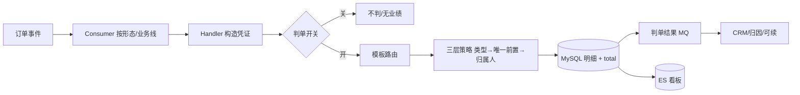

# 业绩归因系统（performance-attribution）

> **非页面条目**。查「订单业绩归谁 / 为什么没业绩 / 判单链路怎么走 / 判单开关在哪」先看这里。
> 代码仓库：`/Users/gaotu/IdeaProjects/JavaProject/performance-attribution`，分支 `feature-fix-judge-reason-scene-tiebreak`；2026-10-20 静态梳理 + 三份飞书方案交叉核对。
> 代码里 topic / 表名 / 配置默认值多带 `_test`，**线上实际值以 Apollo 为准**。

## 先看哪份飞书

| 文档 | 适合查什么 | 链接 |
|---|---|---|
| 业务前因与全链路（最全，优先） | 业务前因、考核谁、判错后果、保护期/归属人动因、客户旅程、判单开关、判单原因、可靠性、运行态坑 | https://gaotuedu.feishu.cn/docx/DE4SdPyaqoJWIDxWKnXcVddgn5F |
| 结构/全景 | 5 类事件源、17 个订单监听器、三层策略模型、MySQL/AnalyticDB/ES、MQ+Job 双保险、已知边界 | https://gaotuedu.feishu.cn/docx/XgpBdx6ZQol4HTxwv75cwnI2nHf |
| 运维排障 | 模块职责、判单开关、存储、已知的坑 | https://gaotuedu.feishu.cn/docx/SaqTdqzCgoiL22xYFnRcaFCdned |

## 一句话定位

把订单事件翻译成可核算的业绩记录：**算给谁、算什么类型、算多少钱、算不算数**；再把结果以 MQ / 看板 / ES / Feign 四种形态给下游。它本质是「激励规则的执行器」，不是单纯的数据加工。

## 端到端链路

关键入口：

| 关注点 | 位置 |
|---|---|
| MQ 总分发 | `web/.../consumer/attribution/AttributionOrderEventConsumer.java:37` |
| 支付 Handler（默认商品） | `web/.../handler/attribution/def/DefaultCourseOrderPaySuccessEventHandler.java:72` / `:183` |
| 判单骨架 | `domain/.../strategy/AbstractPerformanceAttributionJudgeTemplate.java:212` |
| 策略链编排 | 同文件 `:322` `buildStrategyChain()` |
| 判单开关过滤 | 同文件 `:1237` / `:1260` |
| 单类判定主流程 | `domain/.../strategy/AbstractPerformanceAttributionStrategy.java:82` |
| 模板路由（Apollo） | `domain/.../utils/PerformanceAttributionJudgeTemplateUtil.java` |
| 模板路由（老枚举 14 个） | `domain/.../enums/PerformanceAttributionJudgeStrategyEnums.java:29` |
| K12 落库 | `domain/.../strategy/K12AllAbstractPerformanceAttributionJudgeTemplate.java:187` |
| 退款判单 | `domain/.../strategy/refund/AbstractOrderRefundSuccessStrategy.java:56` |
| 判单消息发送 | `domain/.../mq/RocketMqOrderAttributionProducer.java` |
| 看板 ES 同步 | `domain/.../query/synchronizer/PerformanceDashboardSynchronizer.java:50` |

## 上游：三类，别混

1. **事件源**（推消息给本系统）
2. **反查依赖**（判单时本系统主动调它取数）
3. **HTTP 上游**（运营后台/工单工具调本系统改配置、触发回溯）

| 类型 | 来源 | 事件 / 接口 | 用途 |
|---|---|---|---|
| 事件源 | 订单中心 | topic `gaotu_order_event`：`OrderCreatedEvent` / `OrderPaySuccessEvent` / `ApplyRefundDomainEvent` / `OrderRefundSuccessEvent` / `OrderRefundItemSuccessEvent` / `ChooseGiftSuccessEvent` | 主链路触发 |
| 事件源 | 售后 | topic `gaotu_after_sale_event` tag `SUCCESS_EVENT` | 课时包退款判单 |
| 事件源 | 员工组织 | topic `gaotu_staff_event`：`StaffStatusChangeEvent`（离职）/ `OrgChangeEvent`（组织调整）/ `RelationChangeEvent`（汇报关系）/ 员工标签变更 | 不判单，生成看板回溯任务 `performance_attribution_dashboard_backtrack_task` |
| 事件源 | 课程教务 | `gaotu_course_setting_event`：`CLAZZ_CREATE_NOTICE` / `spu_create` / `spu_edit`；`course-center-field-event`：`clazz_lesson_edit` | 初始化判单开关、同步 8027 GPS 配置、重算可续截止时间 |
| 事件源 | 本系统自产 | `gaotu_order_attribution_event`（判单结果；**prod 实例 Bay8En7I**，线上 topic `gaotu_order_attribution_event_prod`）、`gaotu_attribution_monitor_event`（延迟对账） | 下游消费、看板同步、补偿 |
| 反查依赖 | 课程/班级/辅导班 | Feign | 前置订单、续班关系、保护期、归属人、分边 |
| 反查依赖 | 员工/组织/教师 | Feign | 归属人校验、邮箱、看板权限 |
| 反查依赖 | CRM | Feign | 线索、私海、跟进记录 → 归属人 |
| 反查依赖 | 商品中心 / CES | Feign | SPU/SKU、类目路径、学段 |
| 反查依赖 | 售后 / 用户中心 | Feign | 退款申请、退款结果、用户信息 |
| HTTP 上游 | 云帆 / 工单工具 | `/performance/management/**`、`/test/**` | 改判单配置、回溯、导出 |

## 判单开关（“没业绩”最高频真因）

| 形态 | 开关来源 | key | 查不到时 |
|---|---|---|---|
| 线上班课 | `performance_attribution_setting` | `clazz_number` | fallback `judgeIsAttribution` |
| 线下 | 课程数据标签 | `localIsAttributionId=114` | 不判 |
| 课时包 7001 | 直接放行 | — | — |
| OMO / K12 新课时包 8027 | `gps_performance_attribution_setting` | `sku_number` | 不判；回溯/申诉凭证无 skuNumber 时放行 |

**开关只在消息消费瞬间生效，后开不补历史**。新班依赖建班事件初始化配置；建班事件丢了，这个班可能全部不判。补数只能跑回溯 Job，重发消息没用。

默认不判的范围（`AttributionSettingServiceImpl.judgeOriginalClass`）：

- 只判 **专题课 / 系列课**；
- K12 排除：垫班、艺术班、克瑞斯、内部培训、爱马仕、赠课、模拟课堂；
- 成人排除：测试课、赠课、入口班、低价引流课。

## 模板路由：两套并存

| 路径 | 用于 | 机制 |
|---|---|---|
| 老路径 | 大班课 / 1v1 / 小班 Handler | `PerformanceAttributionJudgeStrategyEnums`（14 个模板常量，按 bizLine + productType + isCompensate + operationMode 取 Bean） |
| 新路径 | 默认商品 / 课时包 / 商品中心 | Apollo `performance.attribution.template.config` + `PerformanceAttributionJudgeTemplateUtil`；商品中心另有 `ItemAttributionJudgeTemplateRouter` |

排查先确认这单走哪套，否则会在一套配置里找不到另一套的模板。

## 三层策略模型

| 层 | 回答的问题 | 配置字段 | 实现 |
|---|---|---|---|
| ① 归因类型 | 这是哪种功劳？ | `type_config` | 续班/扩科/召回/拉新/无归属 + 线下 1v1、1vN、课时包变体 |
| ② 唯一前置订单 | 基于哪笔历史订单？ | `pre_order_number_config` | 班型 → 同辅导 → 最早开课 → 最早支付 → 最大辅导班 ID |
| ③ 归属人 | 业绩归到哪个人？ | `employee_config` | 前置辅导老师 / CRM 线索 / sellerId / 班主任 / 主讲 / 最近到课主讲 / 学管 |

三层同在 `performance_attribution_rules_config`，按 `biz_line + product_type + operation_mode` 匹配、`priority` 排序。改规则改配置不发版；代价是配置即生产代码，改错会批量错判。

策略链之外的四个关键机制（排查判单结果异常时都要想到）：

- **四类归因串行短路，命中即停**：四类是互斥的业务解释（已解释为续班就不再算扩科/召回），比四个策略各算一遍再仲裁更可解释；**「无归属」是链尾显式兜底策略**（NonAttributionStrategy，被链执行到即命中），全部未命中且无兜底 = 无判单结果。
- **待支付凭证 = 归属快照**：凭证在订单创建时写入 seller_id，判单认「下单时」的归属，防下单到支付之间销售离职/转岗/线索回收导致漂移；支付单找不到凭证返回 false 触发 MQ 重试（同时兜底支付早于创建的乱序）。
- **替换式写入保幂等**：明细与 `_total` 均按订单维度先逻辑删旧行再插新行，MQ 重复投递、回溯重判收敛到同一份最终状态。
- **三比例分边**：order_ratio（单数）/ price_ratio（金额）/ user_ratio（人数）三口径，联报/扩科/多辅导班按前置拆分合计不超 1；退款冲抵按原比例反向生成扣减行，不重新算比例（支付怎么分、退款怎么扣）。

## 落库与下游

| 存储 | 承载 | 为什么 |
|---|---|---|
| MySQL `gaotu_stat` | 判单明细、凭证、配置、判单原因、可续事实（50+ 表） | 交易型写入，主链路直写 |
| AnalyticDB | `performance_order_attribution_total`、`performance_rank` 等聚合 | 排行榜/全公司查询不拖垮 MySQL |
| Elasticsearch | `performance_dashboard_v2` 看板宽表 | 多维筛选/聚合，由判单消息触发同步 |

分表：K12 / 成人（`_adult`）、已支付 / 待支付（`_no_pay`）、明细 / 汇总（`_total`）。

下游消息 tag：

| tag | 内容 | 使用方 |
|---|---|---|
| `OrderAttributionPaidEvent` | 统一判单结果（成人 + K12） | CRM + 本系统看板同步 |
| `AttributionPayEvent` / `PaidOrderAttributionEventK12` | 成人 / K12 判单 | 归因 |
| `ItemAttributionPaidEvent` / `ItemAttributionNoPayEvent` | 商品维度判单 | 商品业绩消费方 |
| `OrderAttributionJudgeReasonEvent` | 判单原因 | 原因表落库 |
| `AttributionNoPayEvent` | 待支付预判 | 订单跟进 |

## 已知坑（排查顺序：入口/开关 → 判单原因 → 策略配置）

| 坑 | 实际行为 | 影响与处理 |
|---|---|---|
| 判单开关无补偿 | `is_attribution` 只在消费瞬间生效，后开不补历史 | 窗口期订单丢业绩，手动跑回溯 Job |
| 默认不判的班 | 只判专题/系列；K12/成人有排除标签 | 新班窗口期订单可能没业绩，上线前确认开关 |
| 组织维度跟人走最新岗位 | 调岗/离职会把历史业绩整体回刷到最新组织 | 调岗当月看板数据整体移动，属预期 |
| 成人独立表 | 成人走 `_adult` / `_total`，K12 走主表 | 查数据先分业务线，混查必漏 |
| 筛选链兜底最大班 ID | 所有条件都区分不开时取最大辅导班 ID | 极端场景归到“班 ID 最大”的班，看 `uniqueOrderResult` |
| 转化期限制 | 招生归因只认正常转化期 15 天、延长转化期 60 天内的引流课/低价课 | 超期不算招生业绩 |
| 课时包开关差异 | 7001 直判；8027 查 GPS，查不到不判 | 8027 查 `performance_attribution_setting` 永远查不到 |
| 判单原因异步 | `OrderAttributionJudgeReasonEvent` 异步写 `performance_attribution_judge_reason` | 与结果有短暂不一致；结果表为准，原因表看过程 |
| 可续配置删除死结 | 可续类型设「无」时 `wide_clazz_protect_window_config` 被**物理删除**，标记与回溯第一步查不到就静默跳过 | 回溯永久空转且照报「成功」；顺序：先恢复配置 → 删续班关系 → 回溯 → 再改回「无」 |
| 凭证表 ≠ 消费记录 | 调课单走继承分支不写凭证表 | 凭证表没记录不代表消息没消费 |
| 主表索引限制 | `performance_order_attribution` 无 clazz_number 前导索引 | 按班级号直查业绩表必超时，改走其它查询路径 |
| total 双写一致性 | 明细已写、total 或 ES 未同步属短暂窗口 | 先删后插替换式写入保幂等；发现持续不一致跑定时对账 / 回溯 |

## 已核口径（引用前看这里）

- `@OnsMessageListener` **32 个**（web 26 + domain 6），订单域 **17 个**；
- `@JobHandler` **61 个**；
- `PerformanceAttributionRemoteService` **25 个**映射；
- ES 索引 `performance_dashboard_v2`；mapper 覆盖 **50+ 表**；
- 不要引用“33 个监听器 / 24 个接口”，口径对不上代码。

## 关联

- 判单配置页面（云帆）：[yunfan/newJudgeConfig/_page.md](../yunfan/newJudgeConfig/_page.md)
- 可续回溯页面（云帆）：[yunfan/orderRecall/_page.md](../yunfan/orderRecall/_page.md)
- 业绩看板页面：[goods/achievementDetail/_page.md](../goods/achievementDetail/_page.md)
- 天工数仓任务（数据平台）：[数据平台/天工数仓任务与代码.md](../数据平台/天工数仓任务与代码.md)
